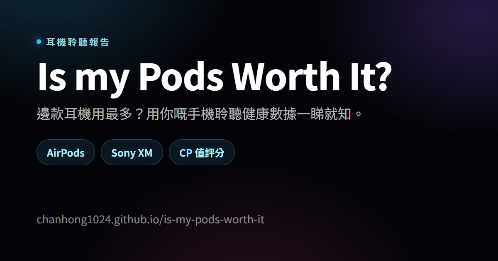

# Is my Pods Worth It?

> AirPods 分型號聆聽統計工具 · 100% 本地離線解析 Apple 健康匯出檔

**繁體中文（香港）** | [繁體中文（台灣）](README.zh-TW.md) | [简体中文](README.zh-CN.md) | [English](README.md) | [日本語](README.ja.md) | [한국어](README.ko.md)

🔗 **Live Demo：** https://chanhong1024.github.io/is-my-pods-worth-it/

一個純前端嘅靜態網站，用 Apple「Liquid Glass」玻璃擬態 UI 打造。你只需要將 iPhone「健康」App 匯出嘅 `export.zip`（或 `export.xml`）拖入去，佢就會自動：

- 提取每筆 `HeadphoneAudioExposure`（耳機音量）紀錄入面嘅硬件型號（Model ID）與裝置名稱
- 按型號分組，計出：
  - 總聆聽時長
  - 時間加權平均音量
  - 最高記錄音量
  - 使用日期範圍
  - 取樣紀錄筆數
  - **建議零售價（RRP）**
  - **每小時聆聽成本**
  - **CP 值評分（0–100）**

## 特點

- 🔒 **100% 本地**：所有解析都喺瀏覽器完成，資料**永不**上傳，離線都用到
- 🎧 **分型號識別**：內置 Apple 耳機 Model 對照表（AirPods 1/2/3/4/5、AirPods Pro 1/2/3、AirPods Max 1/2），可分辨 AirPods Pro 第幾代（Lightning／USB-C 都分到）；亦支援 **Sony XM 系列**（WH-1000XM 頭戴、WF-1000XM 真無線）
- 🔢 **兼容 hex 型號**：部分 iOS 版本喺 export 以 Apple 藍牙 Product ID 顯示（例如 `0x200E`＝AirPods Pro 1、`0x2014`＝AirPods Pro 2），已內置對照；有線 EarPods 亦會自動標示
- 🌐 **六種語言**：繁體中文（香港／台灣）、簡體中文、English、日本語、한국어 一鍵切換，自動偵測瀏覽器語言
- 🧊 **Liquid Glass UI**：Tailwind CSS + 玻璃擬態（backdrop-blur、specular 高光）
- 💰 **CP 值評分**：內置 RRP（HK$，參考值，可自行調整），以「每小時聆聽成本」換算 0–100 分，越高越抵
- 📊 **裝置詳情 Dashboard**：撳卡入獨立詳情頁（可返回、網址可分享），有 KPI、每日/每週/每月使用量圖（含音量走勢線）、日曆熱力圖、星期分佈、每月總量、**Chronodex 24 小時時間分佈錶盤**，同 `7日/30日/90日/1年/全部`＋自訂日期範圍篩選
- 📤 **一鍵生成分享圖**：彈出設定視窗，可揀比例（4:5／1:1／9:16）、深／淺色、排序、勾選要分享嘅裝置、自訂標題、切換每小時成本；即時預覽，可分享到 Threads／IG 或下載 PNG（Canvas 純前端）
- 📱 **響應式**：手機單欄、桌面多欄
- ⚡ **串流解析**：大檔案用分塊（chunk）串流處理，唔會卡死

## 支援語言

| 語言 | 代碼 |
| --- | --- |
| 繁體中文（香港） | `zh-HK` |
| 繁體中文（台灣） | `zh-TW` |
| 簡體中文 | `zh-CN` |
| English | `en` |
| 日本語 | `ja` |
| 한국어 | `ko` |

右上角下拉選單可隨時切換，選擇會記住；首次到訪會自動偵測瀏覽器語言。

## 支援裝置

- **Apple**
  - AirPods（第 1–5 代，包括 ANC 同無線充電版本）
  - AirPods Pro（第 1–3 代；Lightning 同 USB-C）
  - AirPods Max（第 1 代 Lightning／USB-C，以及 Max 2）
  - EarPods（有線）
- **Sony**
  - WH-1000XM3 / XM4 / XM5 / XM6（頭戴式）
  - WF-1000XM3 / XM4 / XM5（真無線）
- 未知或其他藍牙／有線裝置會自動分組並標示。

## 使用方法

1. 喺 iPhone 開「健康」App → 右上角個人頭像 → **匯出所有健康資料**
2. 將匯出嘅 `export.zip` 拖入網頁（或者揀 `export.xml`）
3. 即時見到分型號統計

> 唔記得步驟？撳上傳區右上角嘅 **?** 掣，會有逐步匯出教學（會跟隨你揀嘅語言）。

## 專案結構

| 檔案 | 用途 |
| --- | --- |
| `index.html` | 只放 HTML 結構 |
| `styles.css` | 自訂樣式（玻璃 UI、圖表、動畫） |
| `app.js` | 解析、圖表、分享圖 |
| `i18n.js` | **介面文字／翻譯**（6 種語言） |
| `svg.js` | SVG 定義 + 裝置插圖 |
| `devices.js` | **支援裝置資料**：型號名稱＋建議零售價。加型號或改價錢改呢個檔 |
| `favicon.svg` / `favicon-32.png` / `apple-touch-icon.png` | 瀏覽器分頁圖示同 Apple touch icon |

想新增裝置：打開 `devices.js`，Apple 喺 `MODEL_MAP` 同 `PRICE_APPLE` 各加一行；Sony 喺 `PRICE_SONY` 加一行。繁中（台灣／大陸）、日文、韓文名稱會自動由 `zh-HK`／`en` 轉換。

## 技術棧

- [Tailwind CSS](https://tailwindcss.com/)（Play CDN，免 build）
- [fflate](https://github.com/101arrowz/fflate)（ZIP 解壓）
- Google Fonts — Noto Sans TC / SC / JP / KR
- 純 HTML + Vanilla JS，無任何後端

## GitHub Pages 部署

1. Push 呢個 repo 上 GitHub
2. 去 **Settings → Pages**
3. 喺「Build and deployment」下面：
   - **Source**：`Deploy from a branch`
   - **Branch**：`master`／`(root)`
4. 儲存後，幾分鐘內會出網址 `https://<username>.github.io/is-my-pods-worth-it/`

## 本地預覽

直接開 `index.html` 就得（`fflate` 同 Tailwind 用 CDN，需要上網 load 一次；之後解析完全離線）。
